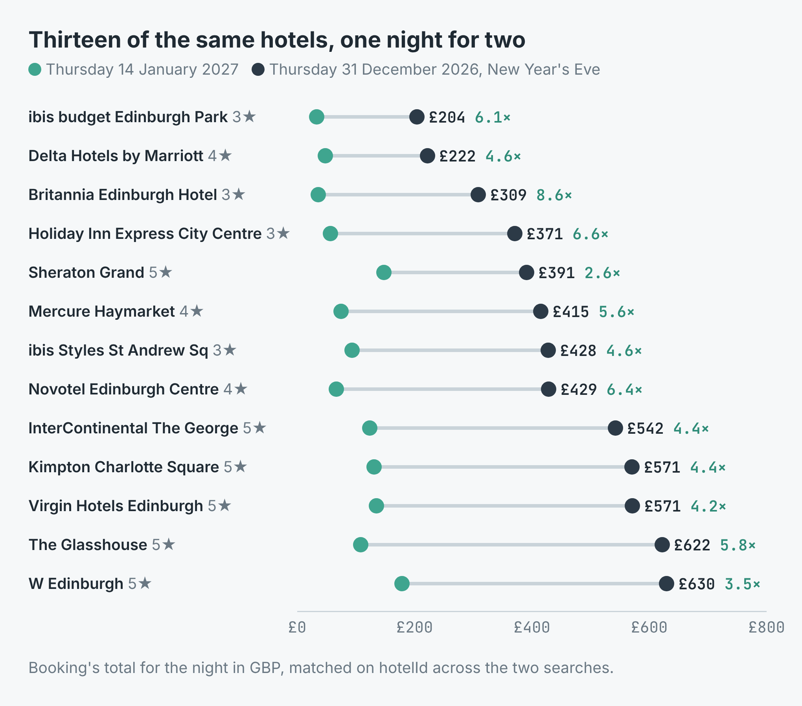
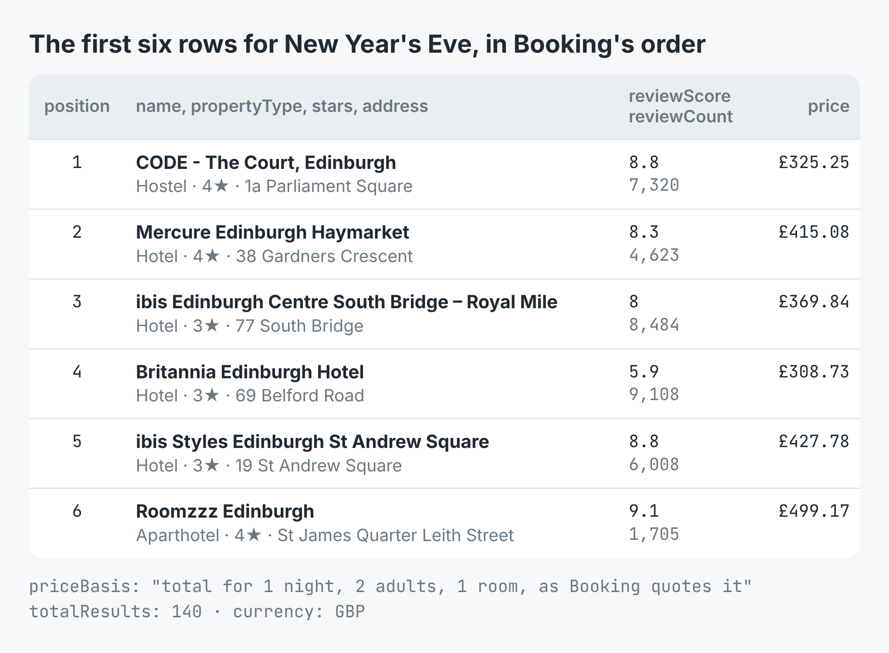
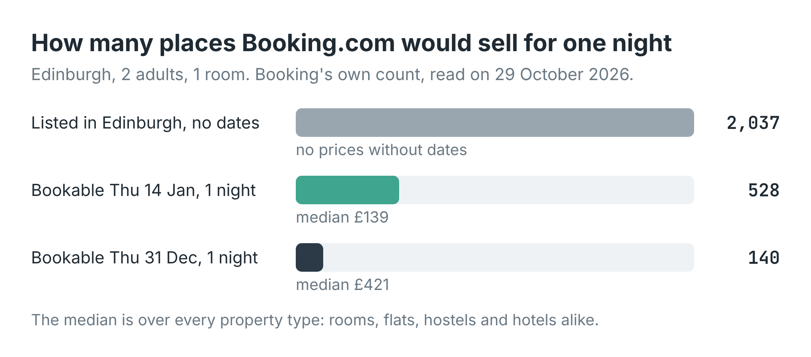

# Booking.com hotel price scraper: compare two dates

Give it a destination and two check-in dates and get every property Booking.com
would sell for one night on each, matched on Booking's own `hotelId`, in a CSV:
the total for each night, and how many times dearer the first date is.

These scripts call [Booking.com Scraper](https://apify.com/simple.actor/booking-hotels)
on Apify. No Booking account, no key and no browser is needed.



The write-up, with a real run on Edinburgh for New Year's Eve against a
Thursday two weeks later, is
[How much more do Edinburgh hotels cost on New Year's Eve?](https://simple-actor.github.io/edinburgh-hotel-prices-new-years-eve-booking-com/)

## Run it

You need an [Apify](https://apify.com) account and its API token, from
Console → Settings → API & Integrations.

**Node** (18 or newer):

```bash
cd node
npm install
APIFY_TOKEN=your_token node compare.mjs Edinburgh 2026-12-31 2027-01-14
```

**Python** (3.11 or newer):

```bash
cd python
python -m venv .venv && . .venv/bin/activate
pip install -r requirements.txt
APIFY_TOKEN=your_token python compare.py Edinburgh 2026-12-31 2027-01-14
```

The arguments are the destination, the first check-in date, the second, and
optionally how many properties to read per date (600 if left out). Each date
is one night for two adults in one room, priced in GBP; change those in the
script for your own booking. Both searches run at once. The scripts print
how many places were bookable on each date and the hotels that rose most, and
write `prices.csv`:

```
2026-12-31: 20 of 140 bookable, 2027-01-14: 20 of 528
  8.65x  £308.73 vs £35.71  Britannia Edinburgh Hotel
  6.21x  £403.97 vs £65.08  ibis Edinburgh Centre South Bridge – Royal Mile
  5.56x  £415.08 vs £74.6  Mercure Edinburgh Haymarket
4 propert(ies) on both dates -> prices.csv
```

That output is from a test with a limit of 20 per date, so few properties
matched. Leave the limit at 600 to read a city like Edinburgh in full.

## What a row looks like

[`sample-output.json`](sample-output.json) holds four real rows, whole: two
Edinburgh hotels, each on both nights.



The fields you will use most:

| Field | What it holds |
|---|---|
| `hotelId` | Booking's numeric ID for the property, stable across runs: join and deduplicate on it |
| `name`, `propertyType`, `stars` | As Booking shows them; `stars` is null for properties Booking does not class |
| `reviewScore`, `reviewCount` | Booking's guest score out of 10 and how many reviews it rests on |
| `price`, `currency` | Booking's total for the whole stay, every night, guest and room you asked for |
| `priceBasis` | What `price` covers, in words: "total for 1 night, 2 adults, 1 room, as Booking quotes it" |
| `pricePerNight`, `originalPrice` | The average per night, and the price before a discount when Booking shows one |
| `totalResults` | Booking's own count of properties for the search |
| `url` | The property's Booking page with your dates and guests already in the link |

## Cost

$0.0015 for each property returned, and nothing for a search that cannot be
read. The Edinburgh comparison returned 140 properties for New Year's Eve and
520 for 14 January: $0.99 in all. Booking's own filter string, in the
`filters` input (`ht_id=204` for hotels only), cuts the rows and so the cost.



## Limits

- Prices move. The same New Year's Eve search four minutes apart gave one
  hostel £325.25 and then £477.25. Each row is Booking's quote at `retrievedAt`.
- The row does not say which room the price is for. Room lists, amenities and
  descriptions are on the hotel's own page, which the scraper does not read;
  `url` opens it.
- A property that is not offered for the night is simply absent. The search
  does not say whether it is sold out or not selling that night.
- A full read can come back a few short of `totalResults` (520 of 528 here).
